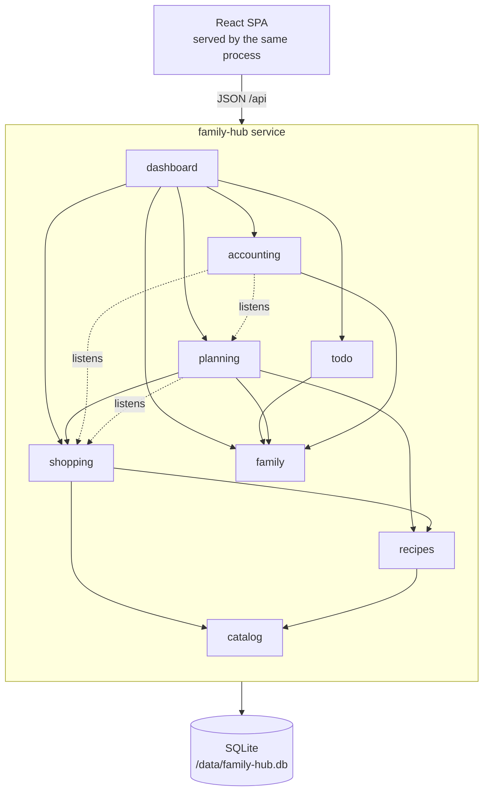
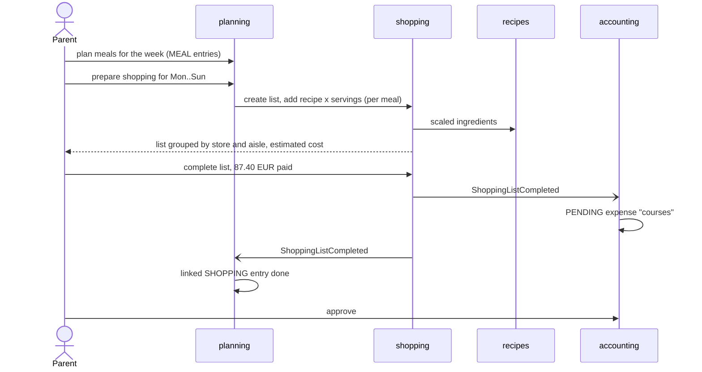
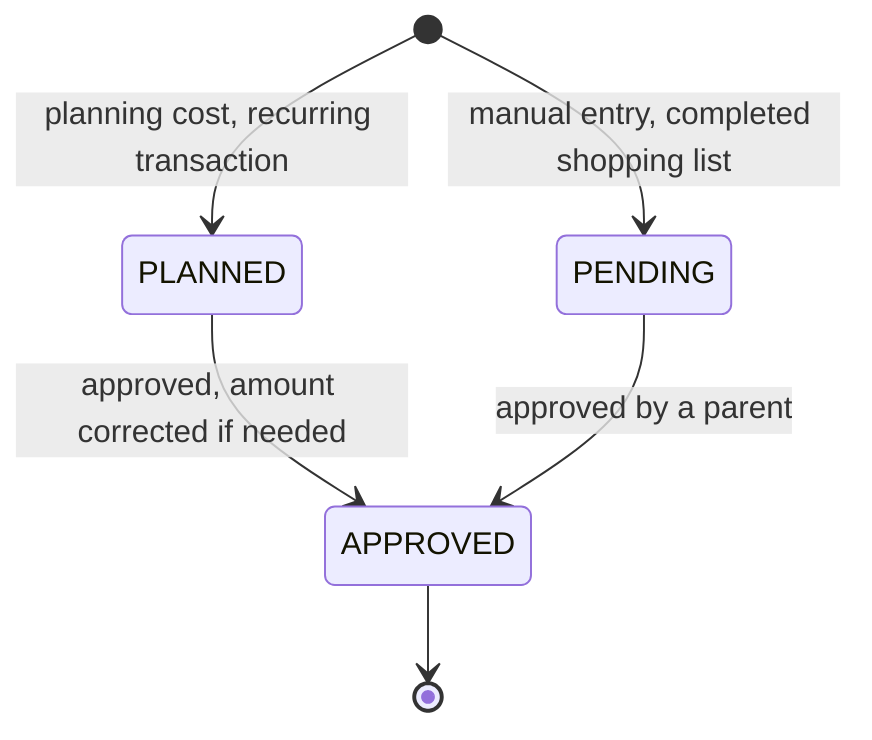
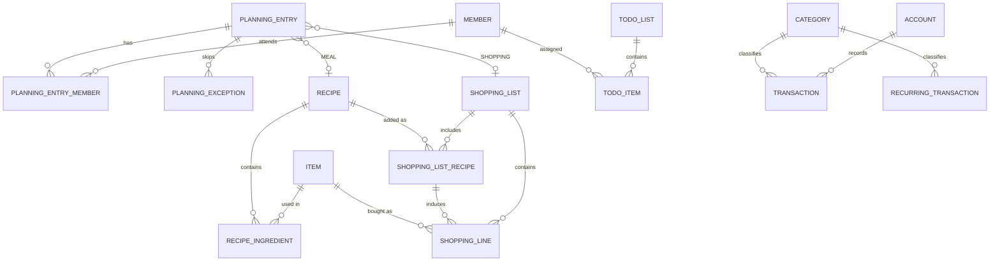

# family-hub architecture

How the family organizer is designed: the problems it addresses, its modules, how they talk to
each other, and the technical choices behind them. Read this before adding a feature.

## 1. Problem and design drivers

What helps a family get organized, according to parenting, budgeting and food-waste guidance
(sources at the end), and how each practice turns into a feature:

| Practice | Why it helps | Feature |
|---|---|---|
| One shared agenda, reviewed weekly | Makes the "who does what" visible and reduces the invisible mental load (*charge mentale*) | Shared planning with members, week and month views, weekly dashboard |
| A named owner for each domain and task | Spreads the load instead of leaving it on one parent | Assignees on planning entries and to-dos, load-per-member indicator |
| Recurring chores written down once | Nobody has to remember them | Recurring planning entries and repeating to-dos |
| Weekly meal plan, shopping list derived from it | Fewer impulse purchases, less food waste | Meal entries in the planning, one-click shopping list from the week's meals |
| Shopping list sorted by shop and aisle | Faster shopping trip | Items carry a store type and an aisle; lists are grouped by them |
| "What can I cook with what I have" | Uses what is already bought | Recipe suggestions from the items of a list |
| 50/30/20 split and envelope budgets (10 to 15 envelopes) | Simple frame plus per-category ceilings | Categories grouped into needs, wants and savings, each with a monthly envelope |
| Bills and contributions known in advance | No surprise at the end of the month | Recurring transactions (utilities, insurance, monthly contribution) generating planned entries |
| Expenses validated by an adult | Keeps the books trustworthy | Pending and planned transactions go through an approval queue |
| Family calendar on everyone's phone | The agenda is consulted where people already look | iCalendar subscription feed per member |

Non-goals for this version: bank synchronisation, double-entry bookkeeping, push notifications,
multi-family hosting. A single-entry ledger with categories and budgets answers "where does the
money go" without the cost of real accounting.

## 2. Modules and features

| Module | Responsibility | Main features |
|---|---|---|
| `family` | Members, authentication, roles | First-run setup, login, members with colour and role (`PARENT`, `CHILD`), calendar feed token |
| `catalog` | Things that can be bought | Items of kind `GOODS` or `INGREDIENT`, store type, aisle, default unit, estimated unit price |
| `recipes` | Cooking recipes | Ingredients (catalog items with quantity and unit), servings, scaling, suggestions from available items |
| `shopping` | Shopping lists | Manual lines and recipe-derived lines, aggregation by item and unit, grouping by store and aisle, estimated cost, completion with amount paid |
| `planning` | Time-boxed family activities | Entries at minute precision, typed (`EVENT`, `SHOPPING`, `MEAL`, `ACCOUNTING`), categories (holidays, day camp, taxes, sport...), recurrence with exceptions, attendees, estimated cost, French public holidays, iCalendar feed |
| `todo` | Unscheduled or loosely scheduled work | Lists, items with assignee, priority, optional due time, repetition |
| `accounting` | Family budget | Accounts, categories with envelopes, transactions (`PLANNED` or `PENDING`, then `APPROVED`), recurring transactions, monthly and yearly reports |
| `dashboard` | Read-only aggregation | Agenda, load per member, overdue to-dos, open lists, budget consumption, approvals to do |
| `admin` | Operations | Consistent database backup download |
| `shared` | Cross-cutting kernel | Errors, money, clock, SQL helpers |

### Planning entry types

A planning entry carries a type and only the fields of that type. The type never embeds data owned
by another module: it holds a reference to it.

| Type | Holds | Links to |
|---|---|---|
| `EVENT` | Category, optional estimated cost | `accounting`: the cost becomes a planned expense |
| `SHOPPING` | Shopping list reference | `shopping`: the list holds the recipes and the ingredients they induce; completing it marks the entry done |
| `MEAL` | Recipe reference and servings | `recipes`, and `shopping` when the week's meals are turned into a list |
| `ACCOUNTING` | Action `REPORT` (month report) or `APPROVAL` (approval session) | `accounting`: the UI opens the report of the entry's month or the approval queue |

Event categories: `VACATION`, `DAY_CAMP` (centre aéré), `TAXES`, `SPORT`, `HEALTH`, `SCHOOL`,
`LEISURE`, `BIRTHDAY`, `HOUSEHOLD`, `UTILITIES`, `OTHER`.

## 3. Architecture

A **modular monolith**: one Spring Boot process, one SQLite database, one container image that also
serves the React user interface. Modules are Java packages whose boundaries are verified by a test
(Spring Modulith): a module only uses the public types at the root of another module's package,
never its `internal` sub-package, and dependencies have no cycle.

Solid arrows are method calls on a module's public API; dotted arrows are domain events.
Every module also depends on `shared`.

### Inter-module links

| Link | Mechanism | Behaviour |
|---|---|---|
| planning → accounting | Events `PlannedExpenseChanged`, `PlannedExpenseCancelled` | An `EVENT` entry with an estimated cost creates or updates a `PLANNED` expense dated on its first occurrence, in the category mapped from the entry category. Removing the cost or the entry deletes it unless it was already approved. |
| planning → shopping | Call | A `SHOPPING` entry references a list, created on the fly if needed. |
| planning → recipes → shopping | Call | "Prepare the shopping for the week": every `MEAL` entry in a date range adds its recipe, scaled to its servings, to a list. |
| recipes → shopping | Call (from shopping) | Adding a recipe to a list adds its ingredients, scaled, as lines tied to that recipe entry. Removing the recipe removes them. |
| shopping → recipes | Query | Recipes ranked by the share of their ingredients present in a list (the UI sends the list's item ids to `recipes`). |
| shopping → accounting | Event `ShoppingListCompleted` | Completing a list with the amount paid creates a `PENDING` expense, categorised from the list's main store type, to be approved by a parent. |
| shopping → planning | Event `ShoppingListCompleted` | `SHOPPING` entries linked to the list are marked done. |
| planning → accounting | UI link | `ACCOUNTING` entries open the month report or the approval queue. |
| todo, planning → dashboard | Query | Load per member over the coming week. |

Events are plain records published with Spring's `ApplicationEventPublisher` and handled
**synchronously, in the publisher's transaction**: completing a list and recording its expense
succeed or fail together. This is the simplest consistent option for a single process and a single
database. Moving a listener to asynchronous delivery later (transactional outbox, Spring Modulith
event publication registry) does not change the publishers.

### Main flows

`PLANNED` entries whose date has passed join `PENDING` ones in the approval queue. Reports count
`APPROVED` amounts as actual, and `PENDING` and `PLANNED` ones together as forecast.

## 4. Domain model

| Concept | Representation |
|---|---|
| Identifiers | SQLite `INTEGER PRIMARY KEY` |
| Money | Integer cents (`long`), euros only, never floating point |
| Quantities | `double` with a unit; units of the same dimension (mass, volume, count) are converted before being added |
| Date-times | Local wall-clock time truncated to the minute (`LocalDateTime`), interpreted in `APP_TIME_ZONE`. A weekly 18:00 activity stays at 18:00 across daylight-saving changes. Stored as ISO-8601 text, which sorts chronologically. |
| Recurrence | Frequency (`DAILY`, `WEEKLY`, `MONTHLY`, `YEARLY`), interval, week days, end date, skipped dates. Mapped one-to-one to iCalendar `RRULE` and `EXDATE`. |
| Enumerations | English codes in the API and the database; the UI translates them to French |

## 5. Technical choices

| Decision | Choice | Alternatives considered |
|---|---|---|
| Shape | Service with an embedded SPA, one image | Static SPA with `localStorage` like `my-todo-list`: data would not be shared between the family's devices. Separate API and UI apps: two images to version together for no benefit at this size. |
| Language and framework | Java 25, Spring Boot 4.1 (Web MVC, Security, JDBC, Actuator, Validation) | Matches the existing Java baseline of the repository |
| Persistence | SQLite file + Flyway migrations | PostgreSQL: a second container to run and back up on a home NAS, and an external service for the tests. SQLite holds a family's data with room to spare, tests run on the real engine, a backup is one file. |
| Data access | `JdbcClient` with explicit SQL | JPA: SQLite only has a community dialect, and lazy loading hides queries. Spring Data JDBC: needs a custom SQLite dialect. |
| Concurrency | One pooled connection | SQLite serialises writers anyway; one connection removes `SQLITE_BUSY` errors. Ample for a family. |
| Module boundaries | Packages + Spring Modulith verification test | Maven modules: more ceremony, same guarantee |
| Authentication | Session cookie, BCrypt passwords, CSRF token for the SPA | Reverse-proxy authentication: depends on the host; HTTP Basic: no logout, weak UX |
| Front end | React 19, Vite, Tailwind CSS 3, hash routing | Same stack as `my-todo-list`; hash routing avoids server-side route fallback |
| Charts | Hand-written SVG and CSS | No chart library needed for bars and gauges |

## 6. Security

| Role | Can |
|---|---|
| `PARENT` | Everything, including accounting, members and backups |
| `CHILD` | Planning, to-dos, shopping, catalog, recipes. No access to accounting, members management or backups |
| Member without login | Appears as an assignee only (young children) |

- The first visit creates the first parent (`/api/setup`), only while no member exists. Do the
  setup before exposing the service.
- Passwords are hashed with BCrypt; sessions are server-side, the cookie is `HttpOnly` and
  `SameSite=Lax`, and `Secure` behind HTTPS (`APP_COOKIE_SECURE=true`).
- State-changing requests require the CSRF token (cookie `XSRF-TOKEN`, header `X-XSRF-TOKEN`).
- The calendar feed is authenticated by a random per-member token in its URL, stored hashed and
  revocable by generating a new one.
- Security headers: Content Security Policy without inline scripts, `nosniff`, frame denial,
  referrer policy.
- All input is validated (Bean Validation on requests, domain invariants in the services); all SQL
  uses bound parameters.

## 7. Runtime

| Concern | Implementation |
|---|---|
| Port | `8080`, UI at `/`, API under `/api` |
| Health | `/healthz` (liveness), `/readyz` (readiness, includes the database) |
| Metrics | `/actuator/prometheus` |
| Traces | OpenTelemetry Java agent shipped in the image, enabled through `JAVA_TOOL_OPTIONS` and `OTEL_*` |
| Logs | ECS JSON on stdout |
| Data | `APP_DATA_DIR/family-hub.db`, a mounted volume; `/tmp` must allow `exec` for the SQLite native library |
| Backup | `GET /api/admin/backup` returns a consistent copy (`VACUUM INTO`) while the service runs; a file copy of `DATA_DIR` needs the service stopped |
| Shutdown | Graceful, 30 seconds |

## 8. Testing strategy

| Level | What | How |
|---|---|---|
| Domain | Recurrence expansion, unit conversion and aggregation, recipe scaling, budget report, recurring schedules, public holidays, iCalendar output | Plain JUnit, fixed dates |
| Module boundaries | No cycles, no access to `internal` packages | `ApplicationModules.verify()` |
| Flows | Setup and login, roles, meal plan to shopping list, list completion to accounting, planning cost to planned expense, approval | `@SpringBootTest` + MockMvc on a temporary SQLite file, fixed clock |
| UI logic | Calendar layout, grouping, formatting | Vitest |

## 9. Roadmap

| Phase | Content |
|---|---|
| 1 (this version) | Modules above, cross-module flows, dashboard, reports, calendar feed, backup |
| 2 | Pantry inventory feeding recipe suggestions and shopping lists; bank statement import (CSV, OFX) with matching of planned transactions; per-line prices and price history per store |
| 3 | Reminders (e-mail or ntfy push), French school holidays import (zones A/B/C), chore rotation and pocket money, savings goals, important documents with expiry dates |

## Sources

- Mental load and shared planning: [Allodocteurs, charge mentale](https://www.allodocteurs.fr/bien-etre-psycho/psycho/qu-est-ce-que-la-charge-mentale_23304.html), [Slate, cinq stratégies](https://www.slate.fr/enfants/allegez-charge-mentale-parents-famille-organistation-ia-planning-automation), [Cocoon family planner](https://www.cocoon.fr/app/uploads/2025/06/cocoon-family-planner.pdf)
- Meal planning and shopping: [Utah State University, meal planning against food waste](https://extension.usu.edu/nutrition/research/food-waste-part-2), [UF/IFAS, meal planning without waste](https://blogs.ifas.ufl.edu/hillsboroughco/2020/07/10/the-best-way-to-meal-plan-without-food-waste), [Keep Britain Tidy pilot](https://www.keepbritaintidy.org/node/35992)
- Budgeting: [Les clés de la banque, méthode des enveloppes](https://www.lesclesdelabanque.com/particulier/budget-methode-enveloppes/), [Caisse d'Épargne, planifier son budget](https://www.caisse-epargne.fr/epargner/planifier-budget/), [Finary, règle 50/30/20](https://finary.com/fr/blog/finance-perso/budget/regle-50-30-20)
- Existing products: [Care.com, family organizer apps](https://www.care.com/c/?p=1477) (Cozi, Picniic, OurHome, TimeTree)
