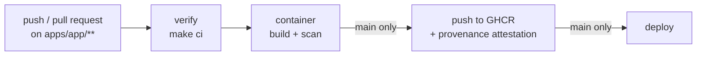

# CI/CD

Each app has its own workflow, triggered only by changes in its directory. Shared steps live in reusable workflows so that every app is verified, packaged and published the same way.

## Workflows

| File | Trigger | Purpose |
|---|---|---|
| `app-<app>.yml` | push to `main`, pull request, manual; filtered on `apps/<app>/**` | Entry point for one app: chains the reusable workflows and its deployment. |
| `reusable-node.yml` | called | Sets up Node.js from `.nvmrc` and runs `make ci`. |
| `reusable-container.yml` | called | Builds the image, scans it, and when `push: true` publishes it to GHCR with a build provenance attestation. |
| `codeql.yml` | push to `main`, pull request, weekly | SAST for all code and for the workflows themselves. |
| `dependency-review.yml` | pull request | Blocks new dependencies with high or critical vulnerabilities. |

Dependabot (`.github/dependabot.yml`) opens weekly update pull requests for GitHub Actions, npm and Docker base images in every `apps/*` directory.

## Pipeline of an app

| Stage | Pull request | `main` |
|---|---|---|
| verify | yes | yes |
| container build and scan | yes | yes |
| image push and attestation | no | yes |
| deploy | no | yes |

## Images

- Registry: `ghcr.io/<owner>/<repo>/<app>`.
- Tags: `sha-<full commit sha>` on every push to `main`, plus `latest`. Deploy by digest or by `sha-` tag, never by `latest`.
- Labels: OCI `org.opencontainers.image.*` labels, including the source commit.
- Scan: Grype fails the build on high or critical vulnerabilities that have a fix available.
- Provenance: verify an image with `gh attestation verify oci://ghcr.io/<owner>/<repo>/<app>:sha-<sha> --owner <owner>`.

## Deployment targets

| Target | When to use | Notes |
|---|---|---|
| GitHub Pages | One static site per repository | Pages hosts a single site: only one app can own it. `tasks` currently does. |
| Container platform (Kubernetes, Azure Container Apps, ...) | Every other app | Pull the image from GHCR by digest. Declarative deployment (for example an ArgoCD-managed manifest repository) is kept outside this repository. |

## Supply chain rules

- Third-party actions are pinned to a full commit SHA with the version in a trailing comment; Dependabot updates both.
- Base images are pinned by digest in each `Dockerfile`.
- `GITHUB_TOKEN` is read-only by default; write scopes are granted per job only where needed.
- `actions/checkout` runs with `persist-credentials: false`.

## Repository settings

These settings are not stored in the repository and must be configured once in GitHub:

| Setting | Value |
|---|---|
| Settings → Pages → Source | GitHub Actions |
| Settings → Code security | Dependency graph, Dependabot alerts and security updates, secret scanning, push protection and private vulnerability reporting enabled |
| Settings → Rules → main | Require a pull request, block force pushes, require the `codeql` and `dependency-review` checks |
| Packages → `<app>` → Visibility | Public, or grant access to the consumers of the image |

Per-app checks are path-filtered and are skipped when an app is untouched, so they cannot be marked as required directly: a required check that never runs blocks the pull request.

## Adding a workflow for a new app

Copy `app-tasks.yml` to `app-<app>.yml`, replace `tasks` with the app name, pick the reusable verify workflow matching the stack, and keep or remove the deployment job. For a stack without a reusable workflow yet, add `reusable-<stack>.yml` following `reusable-node.yml`: set up the toolchain from the app's pin file, then run `make ci`.
